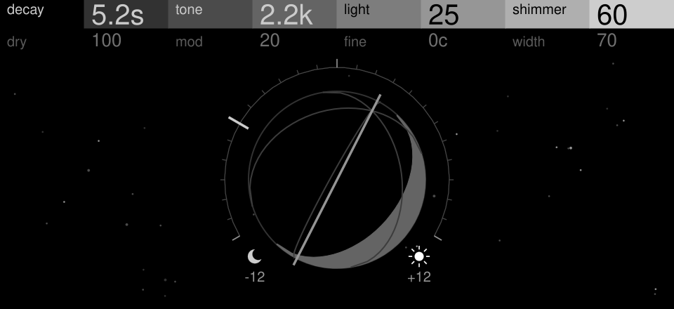

# Xyphemera

Open-XY machines for the OP-XY: effects about light, time and memory. Each lives
in its own folder, with its own definition, tests, README and catalog entry.

| Machine | Screen | Kind | What it is |
| --- | --- | --- | --- |
| [earthshine](earthshine/README.md) | [](earthshine/README.md) | send effect | A unique take on a bipolar shimmer verb, with a UI that takes the perspective of exploring the musical and emotional impact of light touching the earth |

## Build it yourself

Until these machines are in the [Open-XY builder](https://github.com/etcetc000/open-xy/blob/main/docs/builder.md),
you can build them into your own firmware with the Open-XY SDK. This writes a
modified OS to your OP-XY: read the SDK's [caveats](https://github.com/etcetc000/open-xy#readme)
first. The SDK's authors say a faulty image may not be recoverable; the stock
OS update restores the original. No firmware is shared here or anywhere else:
the build starts from the OS on your own device.

You need Python 3.11 or later, on Windows x86_64, Apple-silicon macOS or
Linux x86_64. The SDK's [firmware build guide](https://github.com/etcetc000/open-xy/blob/main/docs/build.md)
covers each step in detail.

1. Get the SDK, this repository and Open-XY's core machines side by side, and
   the SDK's pinned tools (on Linux, build them with Docker instead, as
   [the guide](https://github.com/etcetc000/open-xy/blob/main/docs/build.md#on-linux) shows):

   ```sh
   git clone https://github.com/etcetc000/open-xy
   git clone https://github.com/codebrulee/xyphemera
   git clone https://github.com/etcetc000/open-xy-core-machines
   cd open-xy
   python sdk.py toolchain fetch
   ```

2. Copy `os.ldr` (OS 1.2.1) from your OP-XY into a folder outside these
   checkouts, as in the guide's
   [step 2](https://github.com/etcetc000/open-xy/blob/main/docs/build.md#2-copy-the-os-from-your-op-xy).
3. Build, with one `--machine` for each machine you want: here Earthshine and
   the core Macro Osc synth:

   ```sh
   python sdk.py build --machine ../xyphemera/earthshine \
     --machine ../open-xy-core-machines/machines/macroosc \
     --stock-os <your folder>/os.ldr --profiling off --out <builds>/earthshine-001
   ```

   Keep `<builds>` outside the checkouts too. Pass the package's `layout.json`
   to your next build with `--layout`, so machines keep their numbers and your
   projects still open.
4. Install `<builds>/earthshine-001/candidate` as the guide's
   [step 5](https://github.com/etcetc000/open-xy/blob/main/docs/build.md#5-install)
   describes: copy the files in file-transfer mode (or with
   `python sdk.py device push`), then write the OS from the boot menu.
5. On an FX send track, Shift + M1 opens the effect list; choose the effect.

To build a tagged release rather than the latest, check out its tag first,
for example `git -C ../xyphemera checkout earthshine-v1.0.2`.

## Develop

Keep the [Open-XY SDK](https://github.com/etcetc000/open-xy) beside this
repository as `../open-xy`, then test a machine:

```sh
python ../open-xy/sdk.py test --machine earthshine
```

`tools/` holds what the machines share: an instruction counter on the GNU
Blackfin simulator, an A/B renderer and CPU probe effects
([tools/README.md](tools/README.md)), and each machine's own measurements in
`tools/measure/<machine>/` (outside the machine's folder, which the SDK checks
as machine code).

## Releases

Each machine is tagged on its own, as `<id>-v<version>` (for example
`earthshine-v1.0.0`); its catalog entry pins that tag, its commit and its
folder, so releasing one never changes another.

Released under the MIT licence ([LICENSE](LICENSE)).
