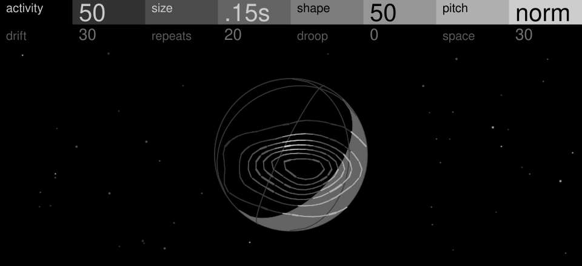
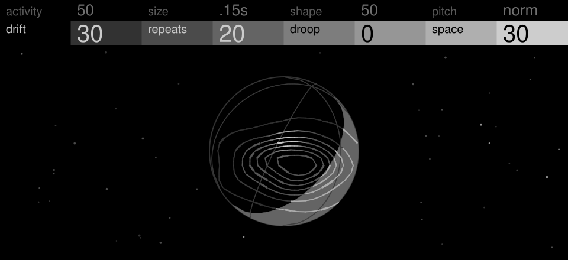
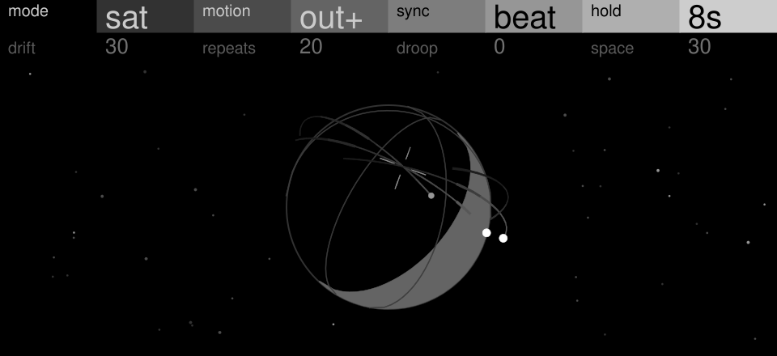
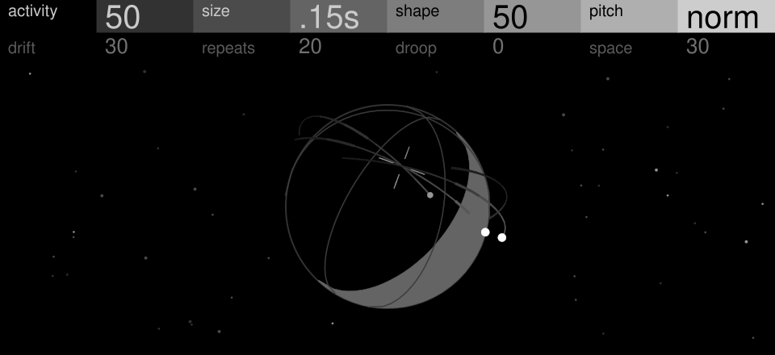
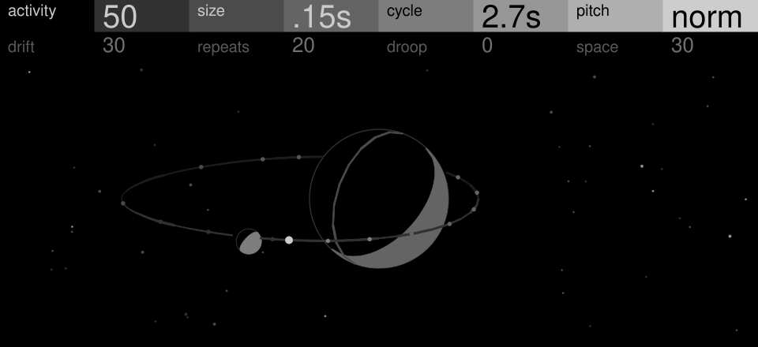
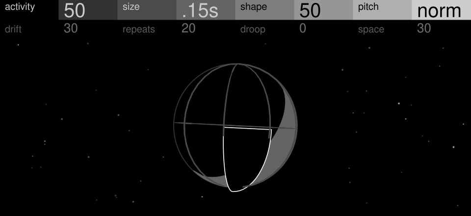

# Earthgrain

A granular looper send effect for the OP-XY. It records what it hears and plays
it back as grains, in four modes: Weather, Satellite, Orbit and Plates. When you
stop playing it holds the last phrase and keeps reading it, so it can drone on
its own. Play into it again and the phrase lets go.
An Open-XY machine, ID `earthgrain`, in the [Xyphemera](../README.md) pack.

| Page 1 (defaults) | Page 2 | Shift held |
| --- | --- | --- |
|  |  |  |

## Modes

Mode is on the Shift row. Each one sounds different and has its own picture of
the Earth (Earthshine's globe):

| Weather | Satellite | Orbit | Plates |
| --- | --- | --- | --- |
|  |  |  |  |

- **Weather:** random grains from the last moments of the recording, or from
  anywhere in a held phrase: a cloud of them. Each grain is represented as a pressure system on
  the screen; the isobars are its contours, flashing while it sounds.
- **Satellite:** a play point moves through the recording, with
  grains laid evenly along it, so the sound slows down without changing pitch.
  When you play a new note it jumps to it. On the screen the Earth's turn is the
  recording's time, and four satellites, one for each grain voice, orbit it.
- **Orbit:** grains with spacing that widens and narrows over each cycle, like
  a spring. On the screen the moon's distance from the Earth is the gap between
  grains, and each grain leaves a mark on its orbit.
- **Plates:** the phrase cuts where its notes and hits begin, each then played one
  after another. On the screen the globe is split into sixteen plates, and each
  piece lifts as it plays.

The screen follows the controls, not the audio: the grains it shows are
imagined with each mode's own timing. (These pictures are drawn on a computer
from `display.cpp`'s frames with the panel artwork, so the fonts may differ from
the device's.)

## Controls

| | 1 | 2 | 3 | 4 |
| --- | --- | --- | --- | --- |
| Page 1 | Activity | Size (20 ms to 1.2 s) | Shape (Orbit: cycle) | Pitch |
| Page 2 (press) | Drift | Repeats | Droop | Space |
| Shift | Mode (Weather, Satellite, Orbit, Plates) | Motion | Sync (free, tempo) | Hold (forever, 64 s to 1 s, off) |

- **Activity** is how busy the grains are. Weather: up to 60 grains a second.
  Satellite: how fast the play point moves (at 0 it stands still). Orbit: how
  close the grains come at their closest (64 ms to 8 ms apart).
  Plates: how often a piece plays (0.6 s apart to 37 ms). With Sync on tempo
  it picks a note value, 1/8 to 1/64.
- **Size** is each grain's length; in Plates, at most how much of each piece plays.
- **Shape** is each grain's envelope, from a soft swell to a pluck. In Orbit it
  is the orbit's size instead: a whole cycle out and back takes 0.25 s to
  30 s (half a beat to 64 beats on tempo), and a small one only opens a
  little. The screen's header calls it `cycle` there.
- **Pitch** is the set of intervals grains choose from: normal, unison, oct
  down, oct up, fifths, octaves, reverse, harmonic. Normal is never detuned;
  unison is the same speed but detuned by Drift, so it choruses.
- **Drift** scatters the grains in time and across the stereo field, detunes
  them by up to 25 cents (except Normal), and in Plates plays the pieces more
  and more out of order.
- **Repeats** feeds the output back into the recording, darkened. While a
  phrase is held, it slowly rewrites the phrase with what the grains play, at
  the phrase's own loudness, so the drone evolves without fading or building up.
- **Droop** bends the grains' pitch by up to an octave. In Orbit it follows the
  grains as they spread out; in the other modes a slow sway (4 s, or 2 bars on tempo).
- **Space** is a light reverb after the grains, about 0.4 s to 2.3 s, on the
  playing as well as the grains, so the change from one to the other is smooth.
- **Motion** shapes the cycle Droop and Orbit follow: breathe (out and back),
  expand (out, then snap back) or contract (in, then snap out), each bending
  down or up.
- **Sync** on tempo locks Activity, Orbit's cycle and Droop's sway to the song.
- **Hold** sets what happens 1 s after the input goes quiet: hold the last
  phrase forever, hold it and fade over 64 s down to 1 s, or not hold at all.

## How it works

- The recording is about 5.7 s long, in 16-bit floating point, so a quiet send
  keeps its detail. The input is scaled up on the way in (the OP-XY's send
  buses run far below full scale) and back down on the way out.
- Up to 16 grains read the recording, each with its own speed, envelope and
  pan. Live, they start as close behind the playing as is safe (2.9 ms), so
  they follow what you play.
- Hold (auto-freeze): after 1 s under about −50 dB it holds the last phrase,
  keeping 1.25 s free for grains still playing and for new recording, so
  neither touches the held phrase. Playing again lets it go.
- Plates finds where notes and hits begin and cuts there; with none (a pad,
  say) it cuts the phrase into eight even pieces.
- Space is two diffusers a side into a loop of four delay lines mixed each pass
  (a Householder mix), at half rate. The grain and reverb inner loops are
  Blackfin assembly (`native/`), checked against their C references on the
  GNU Blackfin simulator (`tools/native-check`).
- When the input and its tail are silent, it rests (about 1% CPU) and wakes on
  the next sound.
- The arithmetic is 32-bit fixed point. The state lives in the send's 512 KB
  buffer.

## Build it yourself

See [Build it yourself](../README.md#build-it-yourself) in the pack README, with
`--machine ../xyphemera/earthgrain`.

## Develop

Keep the [SDK](https://github.com/etcetc000/open-xy) beside this repository as
`../open-xy`, on `staging`, then run the host tests (sound and screen):

```sh
python ../open-xy/sdk.py test --machine earthgrain --cxx clang++ --host-cxx g++
```

Effects have no browser preview. Audition on your OP-XY with the SDK's
[firmware build guide](https://github.com/etcetc000/open-xy/blob/staging/docs/build.md)
and [hardware profiling workflow](https://github.com/etcetc000/open-xy/blob/staging/docs/profiling.md).
Keep firmware and stock content outside every checkout. Agent instructions are
in [AGENTS.md](../AGENTS.md).

Released under the MIT licence ([LICENSE](../LICENSE)).
