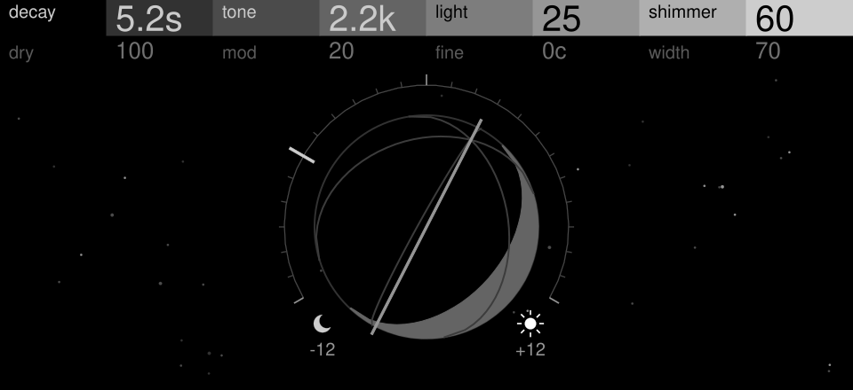
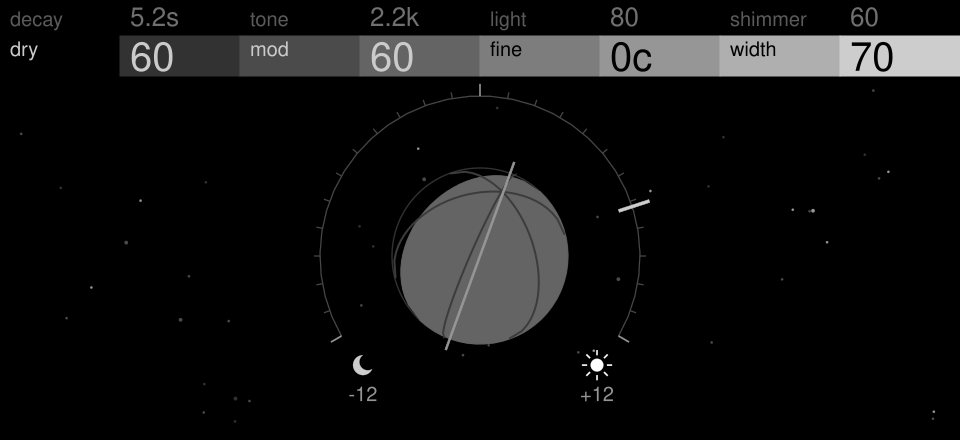
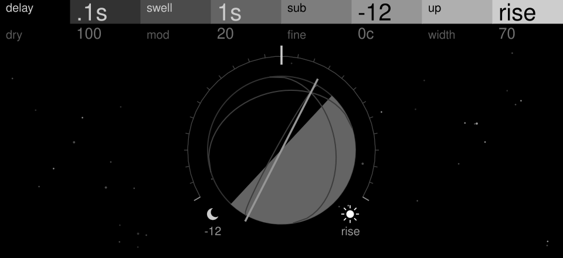

# Earthshine

A shimmer reverb send effect for the OP-XY. A warm, wide tank whose tail is
pitch-shifted back into itself. The **sub** layer sits an interval under the
notes (an octave by default); the **up** layer climbs above them, an octave
at a time or as a halo that rises or falls for ever. Light turns from the moon
(all sub) to the sun (all up); Shimmer sets how much of either.
An Open-XY machine, ID `earthshine`, in the [Xyphemera](../README.md) pack.

| Page 1 (defaults) | Page 2 | Shift held |
| --- | --- | --- |
|  |  |  |

The screen is the Earth with a dial controlling the amount of light hitting it. Light turns
the dial and the Earth, Dry sets its size, Mod makes
its axis wobble. With Shift held, you can control the shimmer intervals. (These are drawn on a computer from
`display.cpp`'s frames with the panel artwork, so the fonts may differ from the
device's.)

## Controls

| | 1 | 2 | 3 | 4 |
| --- | --- | --- | --- | --- |
| Page 1 | Decay (1 to 20 s) | Tone (dark to bright) | Light (moon to sun) | Shimmer |
| Page 2 (press) | Dry | Mod | Fine (stretch ±25 cents, or the halo's character) | Width (mono to wide) |
| Shift | Delay (0, 100, 250, 500 ms) | Swell (off, 0.5, 1, 2 s) | Sub (−12, −24, −7) | Up (+12, rise, fall) |

- **Dry** keeps the source in the stock mixer at full send; it does not add
  clean audio to the return.
- **Mod** drifts the tank's delay lines, by up to 10 ms and up to 2.5 times as fast at full. It defaults to 20%, enough to keep the tank's resonances from singling out a note.
- **Light**'s last 5% at each end turns the other layer fully off, and its
  pitch shifter stops working: the far ends are the lightest settings.
- **Delay** holds the shimmer back before it reaches the tank; the reverb itself starts at once.
- **Swell** fades the shimmer in after each note, as a slow follower of the input catches a fast one.
- **Tone** sets the tank's damping, from 700 Hz to 9 kHz.
- **Width** opens the wet from mono (0) to the tank's full spread (70, its default); above 70 a slow autopan sways it, subtle at first and pronounced at 100.
- **Up** is the octave above (+12), or a halo: resonant bands that move through
  the tail, rising (rise) or falling (fall), each fading in at one end and out
  at the other, so the movement never ends. The halo colours the tail without
  shifting its pitch.
- **Fine** stretches the intervals with the octave: up sharper and sub flatter
  as it rises. With a halo it sets the halo's character instead, from fast
  and soft (5 s through its range) to slow and glassy (30 s, sharper
  resonances), and the sub stays exact.

## How it works

- A figure-eight tank (the plate topology Griesinger devised and Dattorro
  published): the input, in mono, through three all-passes, then around one
  loop of two halves, each a diffuser, a delay Mod drifts, damping, a second
  diffuser and a delay, each half's end feeding the other. Five taps a side
  along the loop make the stereo. It runs at half rate (22,050 Hz): dark by
  design, and light enough for the OP-XY. Its loop is long (twice the paper's,
  scaled to the rate), so it has resonances close enough together that low
  notes' tails ring on pitch, and its in-loop diffusers make it dense from the
  first moments.
- Correlation-aligned pitch shifters: each splice lands, to a fraction of a
  sample, where the outgoing and incoming waveforms match, so the layers hold
  pitch (within a cent at the exact intervals; free-running grains drift by
  over a semitone). Each shifter's search for its next splice runs a fixed
  amount every few samples, pausing even mid-comparison, starting early enough
  to finish before the splice is due, so no single block carries it. It
  compares 12-bit copies of the audio with 16-bit multiplies, a coarse pass
  then a fine one around its best.
- The sub layer shifts the input once, in mono, so it stays one interval down
  instead of falling further each pass; the up layer shifts the wet's middle,
  with the note itself, and recirculates, so it climbs, and the tank spreads
  it back to stereo. Half of both goes straight to the output too, so the
  shimmer arrives within about 60 ms (octave) and 80 ms (sub) of a note
  rather than once the tank has built. Once the input falls silent the up
  layer's feedback fades over 0.3 s, so its tail dies with the reverb's
  instead of outliving it. The
  halo takes its place: four band-passes (trapezoidal state-variable filters,
  stable to the top of their range) on the wet's middle, a quarter of the
  range (250 Hz to 6 kHz) apart. Most of it goes straight to the output and a
  quarter recirculates: fed back in full, it piles up whichever of the tank's
  resonances a band lingers on into one tone.
  Mod drifts both halves' delays. Fine's
  stretched octaves stack partials that share no period, so with Fine away
  from centre the recirculating layer wanders a few cents.
- The arithmetic is 32-bit fixed point. The state lives in the send's buffer
  (`tools/make_tables.py` lays it out and sets `bufferBytes`), cleared a slice
  per block at start, during which the effect is silent (about 25 ms).

## Build it yourself

See [Build it yourself](../README.md#build-it-yourself) in the pack README.

## Develop

Keep the [SDK](https://github.com/etcetc000/open-xy) beside this repository as
`../open-xy`, on `staging`; adjust the commands if yours is elsewhere. The
[first-machine guide](https://github.com/etcetc000/open-xy/blob/staging/docs/first-machine.md)
covers prerequisites. Read the
[core machines](https://github.com/etcetc000/open-xy-core-machines) as worked
examples and the [machine API](https://github.com/etcetc000/open-xy/blob/staging/docs/api.md)
for the supported interfaces. Follow the
[UX conventions](https://github.com/etcetc000/open-xy/blob/staging/docs/ux.md);
Macro Osc is the two-page reference. Synth starters with five to eight controls
use the [shared header](https://github.com/etcetc000/open-xy/blob/staging/docs/display.md#two-page-header):
keep its SVG block and update the labels/value captions with your controls.
Columns without alternates repeat the same saved parameter on both rows.
Agent instructions are in [AGENTS.md](AGENTS.md).

Effects have no browser preview. Run the host tests below, then audition on your XY
using the hardware workflow linked below.

```sh
python ../open-xy/sdk.py test --machine earthshine --cxx clang++ --host-cxx g++
```

Extend `tests/` as the machine's behavior grows. The starter is a minimal
implementation, not a finished instrument. Keep generated output outside this
repository. The generated workflow checks source, sound tests and synth previews
on Linux, and compiles the native module on Windows; it never uses a device.
Its `OPEN_XY_REF` starts at `staging`; pin a compatible SDK commit for a release.

## Hardware and publication

Follow the SDK's [firmware build guide](https://github.com/etcetc000/open-xy/blob/staging/docs/build.md)
and [hardware profiling workflow](https://github.com/etcetc000/open-xy/blob/staging/docs/profiling.md).
Keep firmware and stock content outside every checkout. Commit the machine,
build with profiling enabled, install when authorized and collect a run
(see its "Collect a run" section).
The host estimate printed by `test` cannot substitute for those measurements.

For the builder, follow [catalog submission](https://github.com/etcetc000/open-xy/blob/staging/docs/catalog.md#submit-a-machine).
Every new or changed draft/published entry needs a hardware CPU record tied to
its pinned commit. Hardware validation may be performed by a maintainer if you
do not own an XY. Publication remains pending until that evidence is available.

The generated starter is covered by [LICENSE](LICENSE). Preserve notices for
code you reuse and include the licences of any dependencies or ports.
